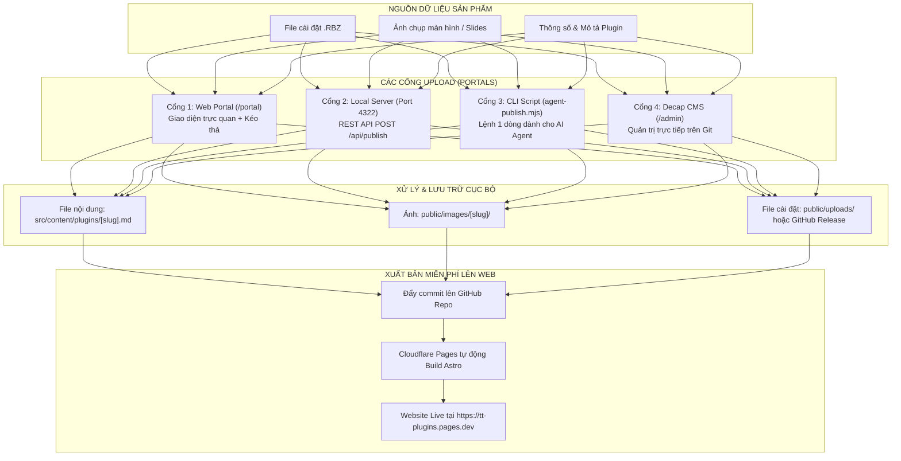

# BÁO CÁO PHÂN TÍCH TOÀN DIỆN CÁC GIẢI PHÁP WEB & LƯU TRỮ MIỄN PHÍ CHO TT PLUGINS STORE

> **Dự án:** TT Plugins — SketchUp Extension Store  
> **Thư mục:** `X:\TT-Plugins-Website-Starter`  
> **Thời điểm lập:** 09/11/2026  
> **Mục tiêu:** Xây dựng, triển khai và vận hành hệ thống website phân phối plugin SketchUp với hiệu năng cao, tốc độ toàn cầu, bảo mật tối đa và **chi phí vận hành 0 VNĐ (100% Miễn phí trọn đời)**.

---

## 1. BẢNG SO SÁNH CÁC NỀN TẢNG HOSTING MIỄN PHÍ TỐT NHẤT

| Tiêu chí | **Cloudflare Pages** *(Khuyên dùng số 1)* | **GitHub Pages** *(Lựa chọn số 2)* | **Vercel** *(Hạng 3)* | **Netlify** *(Hạng 4)* |
|---|---|---|---|---|
| **Chi phí** | **0 VNĐ** trọn đời | **0 VNĐ** trọn đời | **0 VNĐ** (Non-commercial) | **0 VNĐ** |
| **Băng thông (Bandwidth)** | **KHÔNG GIỚI HẠN (Unlimited)** | 100 GB / tháng | 100 GB / tháng | 100 GB / tháng |
| **Tốc độ CDN tại Việt Nam** | **Siêu tốc** (POP tại Hà Nội & TP.HCM) | Tốt (Routing qua Singapore/HK) | Rất tốt | Tốt |
| **Số lượt Build / tháng** | 500 builds / tháng | 2.000 phút GitHub Actions | Không giới hạn build | 300 phút / tháng |
| **Dung lượng trang web** | Lên đến 25 MB / file tĩnh | 1 GB tối đa toàn site | 100 MB / deployment | 100 MB / deployment |
| **Tên miền riêng (Custom Domain)** | Miễn phí + SSL Cloudflare tự động | Miễn phí + Let's Encrypt | Miễn phí + SSL | Miễn phí + SSL |
| **Tích hợp Serverless / API** | Cloudflare Workers (100k req/ngày free) | Không có (chỉ web tĩnh) | Vercel Serverless Functions | Netlify Functions |
| **Kho lưu trữ file tải về** | Cloudflare R2 (10GB free, 0đ egress) | Kết hợp GitHub Releases (2GB/file) | Blob Storage (giới hạn) | Large Media (phức tạp) |
| **Đánh giá tổng thể** | ⭐⭐⭐⭐⭐ **Vô địch về băng thông & tốc độ** | ⭐⭐⭐⭐ **Đơn giản, gắn liền mã nguồn** | ⭐⭐⭐⭐ **Giao diện hiện đại** | ⭐⭐⭐ **Dễ chạm ngưỡng free** |

### Kết luận phân tích Hosting:
- **Cloudflare Pages** là lựa chọn số 1 tuyệt đối: Không bao giờ lo bị tính phí vượt băng thông khi plugin có lượng tải đột biến; CDN Cloudflare tối ưu hóa bộ nhớ đệm (caching) cực mạnh giúp trang web hiển thị gần như tức thì (< 0.2s).

---

## 2. CHIẾN LƯỢC LƯU TRỮ VÀ PHÂN PHỐI FILE CÀI ĐẶT (.RBZ) MIỄN PHÍ

Một rào cản phổ biến khi làm web phân phối extension là: **File cài đặt `.rbz` thường có dung lượng từ 5MB đến 50MB (thậm chí 100MB nếu kèm assets, icons, thư viện nhị phân C++)**. Nếu lưu trực tiếp nhiều file `.rbz` vào thư mục mã nguồn Git (`public/uploads/`), repository sẽ nhanh chóng bị phình to (bloated), làm chậm quá trình clone và build.

Dưới đây là 3 giải pháp lưu trữ file `.rbz` miễn phí tốt nhất:

### Giải pháp A: GitHub Releases (Khuyên dùng số 1 — Tiêu chuẩn phần mềm)
- **Cơ chế:** Tạo Release tương ứng với phiên bản plugin trên repository GitHub (ví dụ: tag `v2.0.0`), sau đó đính kèm file `TT_Bevel_v2.0.0.rbz`.
- **Ưu điểm vượt trội:**
  - Hoàn toàn miễn phí 100%.
  - Cho phép dung lượng file lên đến **2.0 GB / mỗi file đính kèm**.
  - Băng thông tải về không giới hạn qua mạng CDN toàn cầu của GitHub (Amazon CloudFront / Fastly).
  - Link tải trực tiếp vĩnh viễn, người dùng SketchUp hoặc trình duyệt click là tải ngay không qua trang trung gian.
  - Quản lý nhật ký thay đổi (Changelog) và phân biệt rõ bản phát hành chính thức vs bản thử nghiệm (Pre-release).
- **Định dạng link tải trực tiếp:**
  ```
  https://github.com/<USERNAME>/<REPO>/releases/download/<TAG>/<FILENAME>.rbz
  ```

### Giải pháp B: Cloudflare R2 Storage (Lưu trữ hướng mở rộng)
- **Cơ chế:** Dịch vụ lưu trữ đối tượng (Object Storage tương thích S3) của Cloudflare.
- **Ưu điểm:**
  - Miễn phí **10 GB lưu trữ** mỗi tháng.
  - **0 ĐỒNG PHÍ EGRESS (Băng thông tải ra miễn phí 100%)** — đây là điểm khác biệt lớn nhất so với Amazon S3 hay Google Cloud Storage (vốn tính tiền rất đắt khi tải nhiều).
  - Có thể gắn tên miền riêng cho kho tải, ví dụ: `https://download.tt-plugins.com/TT_Bevel_v2.0.0.rbz`.

### Giải pháp C: Link trực tiếp Dropbox / Google Drive
- **Cơ chế:** Upload lên Dropbox hoặc Google Drive của bạn, tạo link chia sẻ và đổi tham số sang tải trực tiếp:
  - Dropbox: Đổi đuôi `dl=0` thành `dl=1` (ví dụ đang dùng trong file `tt-bevel-studio.md`).
  - Google Drive: Dùng cấu trúc `https://drive.google.com/uc?export=download&id=<FILE_ID>`.
- **Đánh giá:** Rất nhanh và tiện cho giai đoạn đầu, nhưng có thể bị giới hạn hạn ngạch (quota) nếu có hàng ngàn lượt tải trong cùng một ngày.

---

## 3. CƠ CHẾ HOẠT ĐỘNG CỦA CỔNG UPLOAD (UPLOAD PORTAL)

Hệ thống đã được trang bị **Cổng Upload Toàn Diện** tại thư mục `X:\TT-Plugins-Website-Starter\tt-plugins`:



---

## 4. QUY TRÌNH TRIỂN KHAI THỰC TẾ TỪ A ĐẾN Z

### Bước 1: Khởi tạo Git & Đẩy lên GitHub
Mở terminal tại thư mục `X:\TT-Plugins-Website-Starter\tt-plugins`:
```bash
git init
git add .
git commit -m "Khoi tao website TT Plugins Store va Cong Upload"
git branch -M main
git remote add origin https://github.com/<YOUR-GITHUB-USERNAME>/tt-plugins.git
git push -u origin main
```

### Bước 2: Kích hoạt Cloudflare Pages
1. Đăng nhập [Cloudflare Dashboard](https://dash.cloudflare.com/) (Tài khoản miễn phí).
2. Chọn menu **Workers & Pages** → Nhấn **Create application** → Thẻ **Pages** → Nhấn **Connect to Git**.
3. Chọn kho chứa `tt-plugins` vừa tạo trên GitHub.
4. Cấu hình thông số Build:
   - **Framework preset:** `Astro`
   - **Build command:** `npm run build`
   - **Build output directory:** `dist`
5. Nhấn **Save and Deploy**. Sau khoảng 1-2 phút, website của bạn sẽ hoạt động chính thức trên toàn cầu tại địa chỉ:
   `https://tt-plugins.pages.dev` (hoặc tên dự án bạn chọn).

### Bước 3: Đăng tải Plugin Mới
Mỗi khi phát triển xong một plugin SketchUp mới (ví dụ `TT_Bevel`):
1. **Dùng Cổng 3 (CLI) nhanh nhất:**
   ```bash
   node scripts/agent-publish.mjs \
     --title "TT Bevel 2.0" \
     --slug "tt-bevel-studio" \
     --category "Modeling" \
     --version "2.0.0" \
     --summary "Vát cạnh và tạo phào chỉ kiến trúc thế hệ mới" \
     --price "paid" \
     --price_label "Bản Pro" \
     --rbz "D:/TT_Bevel_v2.0.0.rbz"
   ```
2. **Commit và đẩy lên GitHub:**
   ```bash
   git add .
   git commit -m "Them plugin TT Bevel 2.0"
   git push
   ```
3. Cloudflare Pages sẽ **tự động phát hiện commit mới và cập nhật website ngay lập tức** trong vòng 60 giây!
